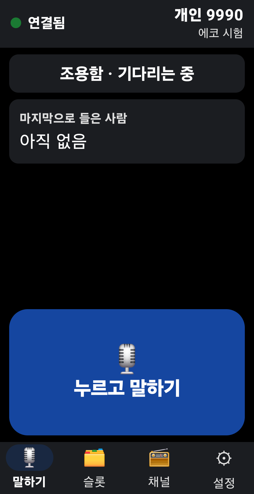
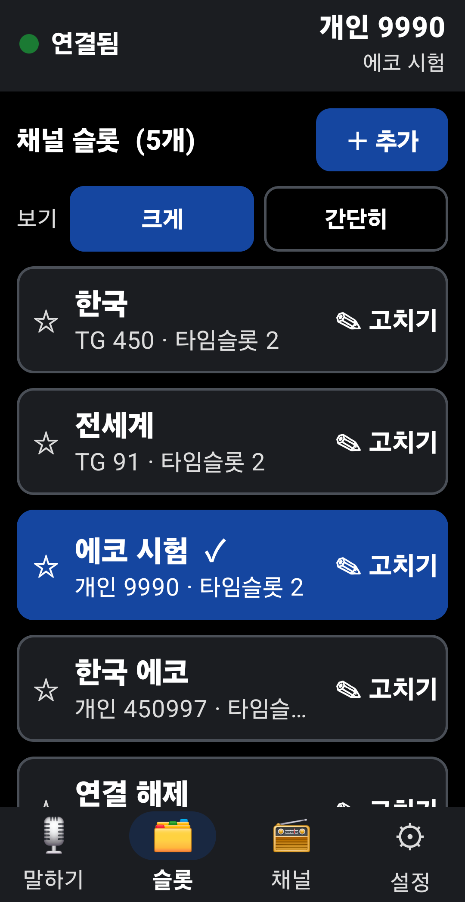
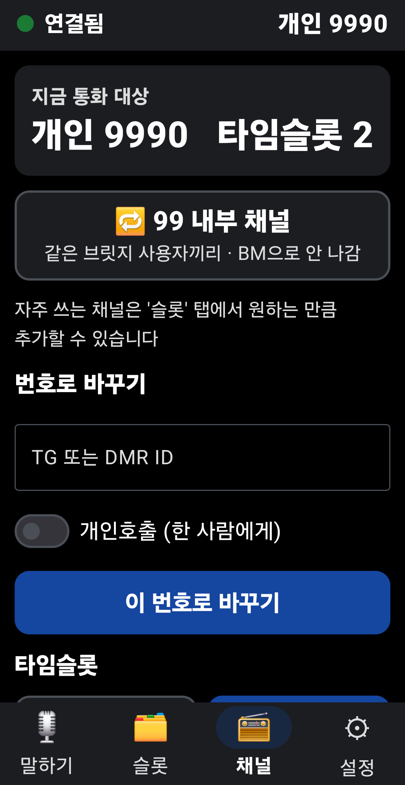
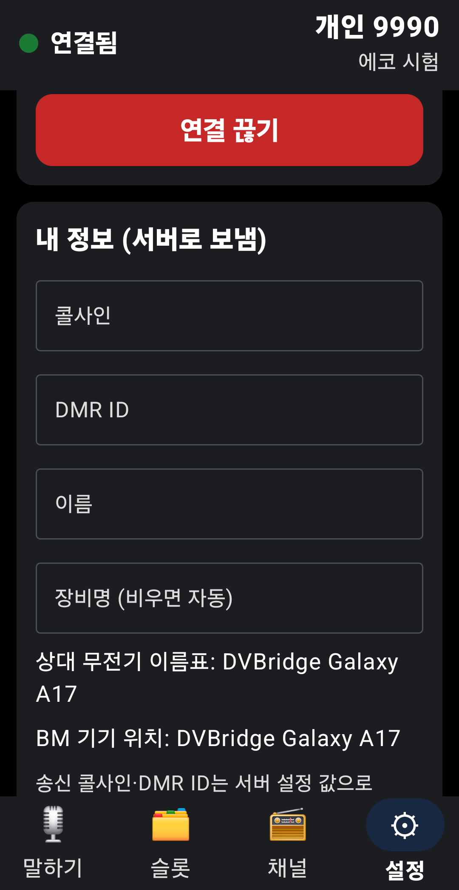
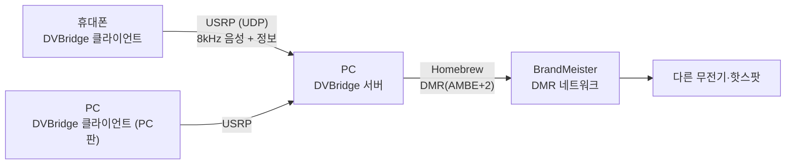
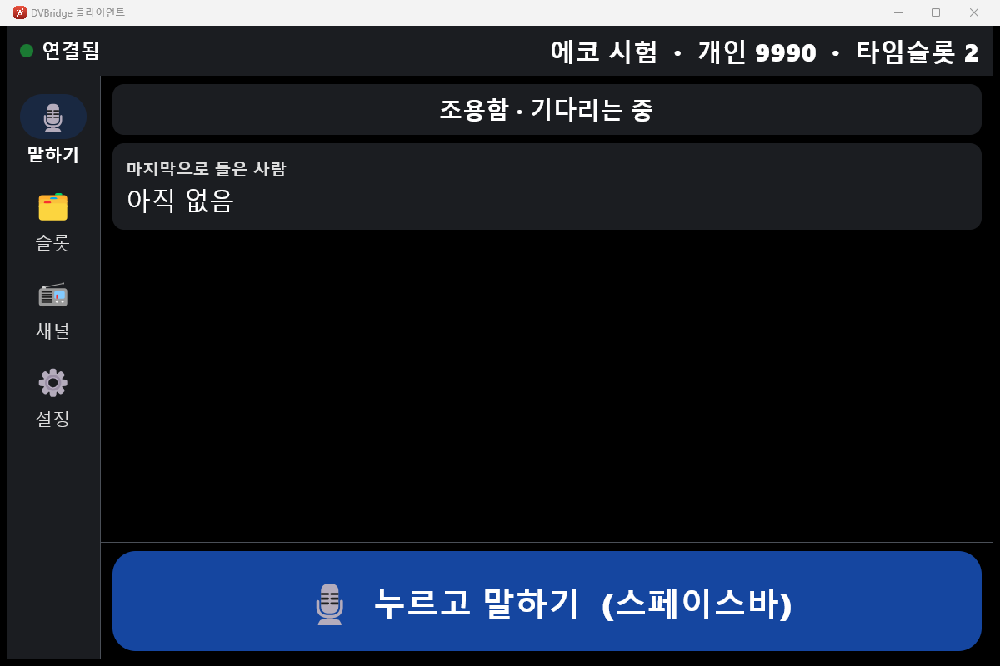

# DVBridge 클라이언트 — 안드로이드

**[DVBridge](https://github.com/seunghunchoi-dev/dvbridge) 전용 휴대폰 앱**입니다.
DVBridge 서버에 붙어서 BrandMeister 등 DMR 네트워크의 무전을 휴대폰으로 듣고, 버튼을 눌러 말할 수 있습니다.
큰 글씨·큰 버튼·쉬운 말로 만들어 어르신도 바로 쓸 수 있습니다.

> 0.4까지는 **DMRBridge 클라이언트**라는 이름이었습니다. DMR 말고 다른 디지털 방식도 담을 수 있게 0.5부터 **DVBridge**로 바꿨습니다(서버도 함께).

<p>




</p>

| | |
|---|---|
| 제작자 | **6K2KZR 최승훈** |
| 라이선스 | [MIT](LICENSE) — 자유롭게 사용·수정·재배포 (저작자 표기 유지) |
| 내려받기 | [Releases](https://github.com/seunghunchoi-dev/dvbridge-client-android/releases) — `DVBridgeClient-0.5.2.apk` |
| 설명서 | [Wiki](https://github.com/seunghunchoi-dev/dvbridge-client-android/wiki) (사진과 함께 따라 하기) · Releases의 PDF |
| 같은 앱의 PC판 | [dvbridge-client-pc](https://github.com/seunghunchoi-dev/dvbridge-client-pc) — 화면·기능 같음 |
| 서버 | [dvbridge](https://github.com/seunghunchoi-dev/dvbridge) — 이 앱이 붙는 Windows 브리지 프로그램 |
| 개인정보 처리방침 | [PRIVACY.md](PRIVACY.md) |

> ※ 송신은 아마추어 무선국 허가(콜사인)와 DMR ID가 있는 분만 하세요.

---

## DVBridge와의 관계

**DVBridge**는 같은 제작자가 만든 Windows용 아마추어 무선 브리지 프로그램입니다.
PC에서 BrandMeister 같은 DMR 마스터에 핫스팟처럼 접속해 두고, 여러 사람의 휴대폰을 그 PC에 붙여 무전을 주고받게 해 줍니다.
이 앱은 그 **휴대폰 쪽**입니다.



- **음성 변환(보코더)은 서버가 합니다.** 앱은 일반 음성(8kHz)만 주고받으므로 앱에는 보코더가 없고, 따로 구할 것도 없습니다.
- **사용자마다 포트가 따로 있습니다.** 서버 운영자가 DVBridge 웹 설정에서 사용자를 만들면 그 사람의 USRP 포트(예: 32001)가 정해집니다. 앱에 그 포트를 넣습니다.
- **송신 콜사인·DMR ID는 서버 설정 값**이 쓰입니다(BrandMeister 접속은 서버가 하기 때문).
- DVBridge의 기능을 앱 화면에서 그대로 보여 줍니다.
  - **브릿지 공지** — 운영자가 보낸 음성 공지(문장 읽어 주기·마이크 방송·예약 공지)를 "📢 브릿지 공지"로 표시
  - **내부 채널** — BrandMeister로 나가지 않고 같은 브리지 사용자끼리만 이야기하는 채널(기본 TG 99). 서버가 켜 두면 채널 탭에 버튼이 생김
  - **상대방 정보** — 서버가 RadioID 명단에서 찾은 콜사인·이름·지역, 상대 무전기가 보낸 이름표(Talker Alias)
  - **서버 알림** — 채널 변경 결과 등 서버가 보내는 안내

통신 규격은 [docs/PROTOCOL.md](docs/PROTOCOL.md)에 정리돼 있습니다.

---

## 화면과 기능

메뉴는 4개(말하기·슬롯·채널·설정)입니다. 일반 휴대폰은 아래쪽에, **폴더블을 펼치거나 태블릿**처럼 화면이 넓으면 PC판과 같이
**같은 메뉴를 왼쪽 세로 줄**에 두고, 맨 아래에 어느 메뉴에서나 누를 수 있는 **가로로 긴 말하기 버튼**을 둡니다(Galaxy Z Fold에서 시험).



### 🎙️ 말하기
- **누르고 말하기** 큰 버튼을 누르고 있는 동안 송신, 떼면 끝
- 설정에서 **한 번 눌러 켜고 다시 눌러 끄기**, **볼륨 아래(-) 버튼으로 말하기**를 고를 수 있음
- 맨 위: 조용함 / 누가 말하는 중 / 내가 말하는 중(시간)
- **마지막으로 들은 사람**: 콜사인 · 이름 · 지역 · 상대 무전기 이름표, 브릿지 공지·내부 채널 표시. BM 자동 응답(4000 연결 해제 안내, 에코)은 숫자 대신 이름으로
- 송신은 한 번에 **180초**가 넘으면 자동으로 멈춤 (서버도 같은 제한)

### 🗂️ 슬롯 (채널 메모리)
- 자주 쓰는 TG·개인호출을 **개수 제한 없이** 저장하고, 누르면 바로 그 채널로
- 이름 · 번호 · 개인호출 · **타임슬롯 1/2** · 그룹
- **★ 즐겨찾기**, 그룹별 보기, 많아지면 **검색**, **크게/간단히** 보기
- 순서 바꾸기(위로/아래로), 삭제는 두 번 확인
- **한국 추천 채널**이 기본으로 들어 있음: 한국 TG 450, 한국 에코 450997, 전세계 TG 91, 아시아·중동 TG 94, 에코 시험 9990, 연결 해제 TG 4000 (예전 사용자는 "＋ 한국 추천 채널 넣기"로 빠진 것만 추가)
- 같은 채널을 연달아 눌러도 한 번만 보내고, 바꾸는 동안 "→ TG 450 로 바꾸는 중…" 표시

### 📻 채널
- 지금 통화 대상과 타임슬롯
- 번호로 바꾸기 (그룹 / **개인호출**)
- **타임슬롯 1 / 타임슬롯 2** 선택
- 🔁 **내부 채널**, 🔊 **9999 내부 에코 시험**(BM으로 안 나감) 빠른 버튼 (서버가 켜 둔 경우)
- **DMR 주소록**: 번호를 넣으면 이름 표시(예: TG 450 = South Korea), 콜사인·이름·채널 이름으로 찾기. BrandMeister 채널 목록과 RadioID.net 한국 명단(공개 자료)을 일주일마다 자동으로 받음

### ⚙️ 설정
- **보기**: 글자 크기(보통·크게·아주 크게), 화면 밝기(자동·밝게·어둡게)
- **서버**: 주소 · 포트 · 연결/연결 끊기
- **내 정보**: 콜사인 · DMR ID · 이름 · 장비명 → 서버로 보냄 (아래 참고)
- **말하기·소리**: 누르기 방식, 볼륨 버튼, **기기 버튼 지정**(무전기폰 PTT 버튼 등), 화면 켜 두기, 듣는 소리·마이크 크기, 스피커 시험
- **DMR 주소록**: 받은 개수·날짜, 일주일마다 자동 받기, 지금 받기
- **기록 보기**: 연결·수신 기록 (문제가 생기면 운영자에게 보여 주기)

### 내 정보와 이름표
앱이 보낸 장비명은 DVBridge가 받아서 두 곳에 씁니다.

| 어디에 | 예 | 길이 |
|---|---|---|
| 상대 무전기 화면의 **이름표**(Talker Alias, ETSI TS 102 361-2) | `N0CALL DVBridge Galaxy A17` | 31자 |
| BrandMeister의 **기기 위치** 칸 | `DVBridge Galaxy A17` | 20자 |

장비명을 비워 두면 휴대폰 모델명(예: Galaxy A17)이 자동으로 들어갑니다. 장비명이 바뀌면 서버가 BrandMeister에 한 번 다시 접속합니다(사용자마다 10분에 1번까지).

### 여러 화면 크기
- **가로로 눕힌 휴대폰**: 메뉴는 왼쪽, 말하기 버튼은 오른쪽에 세로로 길게
- **작은 휴대폰**(무전기폰 등): 글자·메뉴·버튼이 저절로 작아짐
- 화면의 휴대폰 버튼 줄이 있으면 피하고 없으면 꽉 채움 (휴대폰이 알려 주는 크기대로 자동)

### 화면이 꺼져도
앱은 알림창에 "DVBridge 클라이언트"를 띄운 백그라운드 서비스로 동작해서, 화면을 꺼도 수신 소리가 계속 나옵니다.
연결이 끊기면 스스로 다시 연결합니다.

---

## 설치와 처음 설정

1. [Releases](https://github.com/seunghunchoi-dev/dvbridge-client-android/releases)에서 APK를 받아 설치합니다 (안드로이드 8.0 이상).
   "출처를 알 수 없는 앱"을 허용하고, Play 프로텍트 안내가 나오면 "무시하고 설치"를 누릅니다.
2. 처음 열 때 **마이크**·**알림** 권한을 허용합니다.
3. **설정 → 서버**에 DVBridge 운영자에게 받은 **주소**와 **포트**를 넣고 **연결**.
4. 위쪽에 🟢 **연결됨**이 나오면 끝. **설정 → 내 정보**에 콜사인·DMR ID·이름을 넣고 저장합니다.

집 밖(LTE 등)에서 쓰려면 서버 운영자가 외부 접속(공유기 포트 열기 또는 VPN)을 준비해야 합니다.
자세한 내용과 문제 해결은 [Wiki](https://github.com/seunghunchoi-dev/dvbridge-client-android/wiki)를 보세요.

---

## 개인정보

- 입력한 서버 주소·콜사인·DMR ID·이름·장비명은 **사용자가 지정한 DVBridge 서버에만** 보냅니다.
- 마이크는 **말하기 버튼을 누르고 있는 동안에만** 켜지며, 음성은 저장하지 않습니다.
- 광고·분석 도구·위치 정보·계정 로그인이 없습니다. 처음 설치하면 모든 칸이 비어 있습니다.
- DMR 주소록은 BrandMeister·RadioID.net의 **공개 자료를 받아 오기만** 하며, 이때 내 정보는 보내지 않습니다.
- 아마추어 무선 통신은 법적으로 공개 통신이며, USRP 통신은 암호화되지 않습니다.

전문: [PRIVACY.md](PRIVACY.md)

---

## 소스에서 빌드하기

| 필요한 것 | 버전 |
|---|---|
| JDK | 17 |
| Android SDK | API 36 (compileSdk·targetSdk 36, minSdk 26) |
| Gradle | 8.9 (wrapper 포함) |

```bat
build_android.bat
:: 또는  gradlew :composeApp:assembleRelease :composeApp:bundleRelease
```

- 결과: `composeApp/build/outputs/apk/release/` (APK), `composeApp/build/outputs/bundle/release/` (Google Play용 AAB)
- 서명: 저장소 루트에 `keystore.properties`(storeFile, storePassword, keyAlias, keyPassword)를 두면 서명됩니다. 키와 이 파일은 저장소에 올리지 않습니다.
- 폴더 경로에 영문이 아닌 글자가 있으면 `mklink /J`로 영문 경로를 만들어 빌드하는 것이 안전합니다.

### 구조

| 경로 | 내용 |
|---|---|
| `composeApp/src/jvmShared` | **PC판과 똑같은 공통 코드** — USRP 통신(`UsrpClient`), 상태·송신 제한(`Radio`), 소리 변환(`Resampler`), 화면 전체(`App`, Compose) |
| `composeApp/src/androidMain` | 안드로이드 전용 — 마이크·스피커(`AndroidPlatform`), 백그라운드 서비스·알림(`RadioService`), 권한·볼륨 버튼(`MainActivity`) |
| `docs/PROTOCOL.md` | 클라이언트 ⇄ DVBridge 통신 규격 |
| `docs/play-store` | Google Play 등록 자료(아이콘·그래픽·스크린샷·설명문)와 체크리스트 |

Kotlin Multiplatform + Compose Multiplatform으로 PC판과 화면·통신 코드를 함께 씁니다.

---

## 사용한 오픈소스

Kotlin, kotlinx.coroutines, kotlinx.serialization, Compose Multiplatform, AndroidX, Guava listenablefuture — 모두 **Apache License 2.0**.
아이콘은 제작자가 직접 그렸습니다. 보코더(AMBE+2)는 들어 있지 않습니다.

## 관련 프로젝트

- [DVBridge](https://github.com/seunghunchoi-dev/dvbridge) — 이 앱이 붙는 Windows용 DMR 브리지 서버 (MIT)
- [DVBridge 클라이언트 PC판](https://github.com/seunghunchoi-dev/dvbridge-client-pc) — 같은 앱의 Windows판 (MIT)

BrandMeister, RadioID는 각 소유자의 이름이며, 이 프로젝트는 그들과 제휴하지 않은 독립 프로젝트입니다.

---

MIT License · Copyright (c) 2026 최승훈 (Choi Seunghun, **6K2KZR**)
